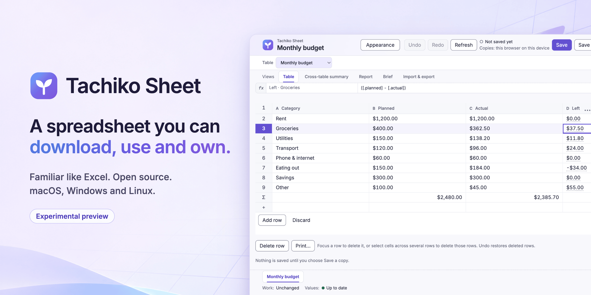
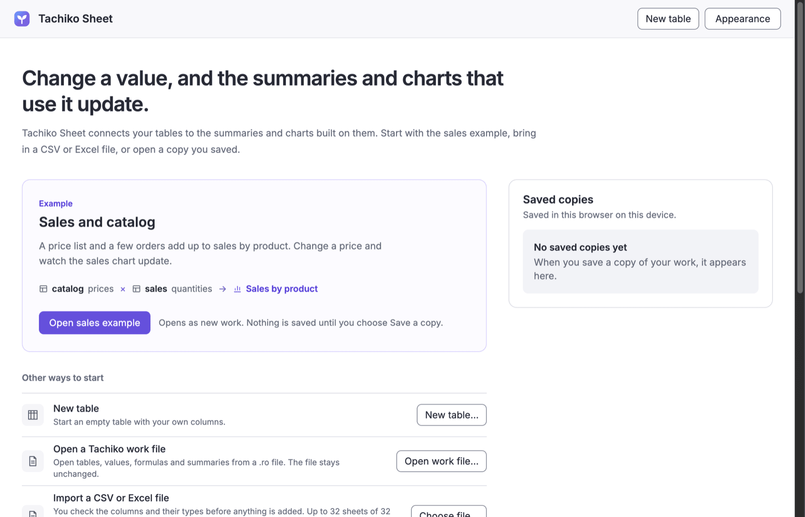
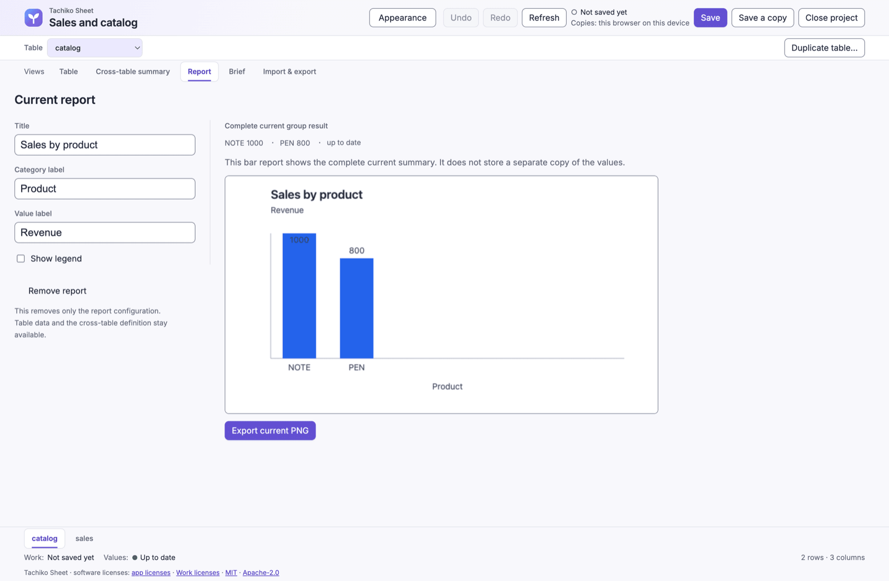
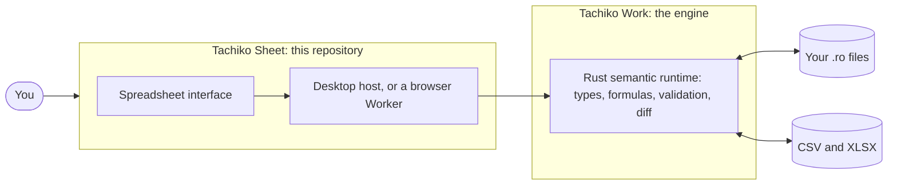

<p align="center">
  
</p>

# Tachiko Sheet

**A spreadsheet you can download, use and own.** It feels familiar if you know Excel, runs on macOS, Windows and Linux, and is the first major client of [Tachiko Work](https://github.com/nurockplayer/tachiko-work), the open engine for user-owned data, formulas and rules.

> [!WARNING]
> **Experimental preview, for early testing only.** Installers are not signed, so your computer warns you the first time. Keep backups of your original files. This is not a claim of full Driver certification, completed human acceptance or general availability.

| At a glance | |
| --- | --- |
| **Download** | [Releases page](https://github.com/nurockplayer/tachiko-sheet/releases), or `brew install --cask nurockplayer/tap/tachiko-sheet` |
| **Platforms** | macOS, Windows and Linux desktop are the v1.0 goal. A Web build exists and follows them. iOS and Android come after v1.0. |
| **Progress** | [v1.0 status #292](https://github.com/nurockplayer/tachiko-sheet/issues/292), [current handoff #2](https://github.com/nurockplayer/tachiko-sheet/issues/2) |
| **Built with** | React, TypeScript and Vite on a [Tauri](https://tauri.app) desktop host. Tachiko Work's Rust runtime does the calculating. |
| **License** | [Apache-2.0](LICENSE-APACHE) or [MIT](LICENSE-MIT) |

## Download

Get the installer for your system from the [Releases page](https://github.com/nurockplayer/tachiko-sheet/releases).

**macOS 13 or later (Apple Silicon or Intel):** open the DMG and drag Tachiko Sheet to Applications. Try to open it once, then go to System Settings > Privacy & Security and choose Open Anyway. With Homebrew: `brew install --cask nurockplayer/tap/tachiko-sheet`.

**Windows 10 or 11 (x64):** run the installer. When SmartScreen says it protected your PC, choose More info, then Run anyway.

**Linux (x64, Ubuntu 24.04 or later):** install the deb with `sudo apt install ./Tachiko-Sheet-*.deb`. Or make the AppImage executable with `chmod +x` and run it; the AppImage needs FUSE 2, which Ubuntu leaves out by default: `sudo apt install libfuse2t64`.

## What you can do today

- **Start quickly:** from a Budget, Invoice, Task tracker or Gradebook template, an empty table, or a CSV or Excel file.
- **Type formulas the way you know them:** A1 cell references, `=B3*C3`, `=SUM(B2:B9)`, and click a cell to insert its address.
- **Work with ranges:** drag to select, copy, cut, paste, and delete several rows at once.
- **Find and filter:** replace with a preview, and filter several columns by picked values or conditions.
- **Keep your numbers connected:** change a value, and the summaries and charts that use it update.
- **Move in and out of Excel:** check columns and types before an import, then export CSV or XLSX with formulas and calculated values.

<table>
  <tr>
    <td width="50%"></td>
    <td width="50%"></td>
  </tr>
  <tr>
    <td align="center">Start from an example, a template or your own file</td>
    <td align="center">Summaries and charts follow your tables</td>
  </tr>
</table>

### Not there yet

Each release's notes list its limits. The main ones right now:

- Windows and Linux are the least tested, and nobody has tried their installers by hand yet.
- Tables of 65 rows or more with text columns can't hold formulas yet.
- The desktop apps have no File > Open or double-click to open.
- Printing is not verified by hand, so check a printout or PDF before relying on it.
- Some CSV and XLSX features and data shapes are unsupported.

## How it fits with Tachiko Work

Sheet is the experience; Work decides what the data means. Formula, validation and storage rules live in Work, not in Sheet's frontend.



Sheet makes Tachiko's [mission](https://github.com/nurockplayer/tachiko-work/blob/main/docs/vision/mission.md) practical: help people move beyond Office and OOXML dependence through a better, open, user-owned product. Everyday spreadsheet usability and Work's semantic capabilities must reinforce each other; an engine demo is not enough. See the [founder clarification](https://github.com/nurockplayer/tachiko-work/issues/486).

Sheet is one client, not the container for every future Tachiko client. Full document editing, slides, ERP and CRM are separate product decisions. Notes, reports and contextual assistance support spreadsheet work here.

## For AI agents

Read [AGENTS.md](AGENTS.md) first; it decides how work happens here. Then:

1. Read live [Mission #1](https://github.com/nurockplayer/tachiko-sheet/issues/1), [handoff #2](https://github.com/nurockplayer/tachiko-sheet/issues/2) and [v1.0 status #292](https://github.com/nurockplayer/tachiko-sheet/issues/292), then the Issue or PR you are working on. This README and the older documents are not the authority.
2. Search both repositories before saying something is absent or undecided, as AGENTS.md describes.
3. Never put canonical state, formulas, validation, semantic revisions or storage rules in frontend code. They belong to Tachiko Work.
4. Report only the checks you actually ran.

| Path | What is there |
| --- | --- |
| `src/ui/` | Spreadsheet interface components |
| `src/application/` | Workflows and policies |
| `src/runtime/` | The resident session that talks to the Work runtime |
| `src/host/` | Browser and desktop effects, such as local copies |
| `src-tauri/` | The desktop host |
| `public/core-kit/`, `core-kit.lock.json` | The pinned Tachiko Work browser kit and its lock |
| `tests/` | Product, desktop and qualification tests |
| `docs/` | Scope, acceptance, delivery and design documents |

```sh
pnpm install --frozen-lockfile
pnpm dev          # the Web build on localhost
pnpm typecheck
pnpm test:unit
```

## Documents

- [Product scope and first slice](docs/SPEC.md)
- [Continuous delivery and merge authority](docs/DELIVERY.md)
- [Full spreadsheet acceptance](docs/PRODUCT-ACCEPTANCE.md)
- [Prepared executable tests](docs/ACCEPTANCE.md)
- [Upstream authority and issue routing](docs/UPSTREAM.md)
- [Product and architecture principles](docs/PRODUCT-PRINCIPLES.md)
- [Desktop host and upstream dependencies](docs/DESKTOP.md)
- [Research index and decision provenance](docs/research/README.md)

## License

Code is dual-licensed under [Apache-2.0](LICENSE-APACHE) or [MIT](LICENSE-MIT), the same terms as Tachiko Work (the founder's direction in [tachiko-work#15](https://github.com/nurockplayer/tachiko-work/issues/15), which covers baseline local clients). External code contributions stay paused, as in Tachiko Work's [licensing posture](https://github.com/nurockplayer/tachiko-work/blob/main/docs/governance/licensing-posture.md). Public visibility is not a compatibility certification or an invitation to bypass Tachiko Work's contribution gates.
